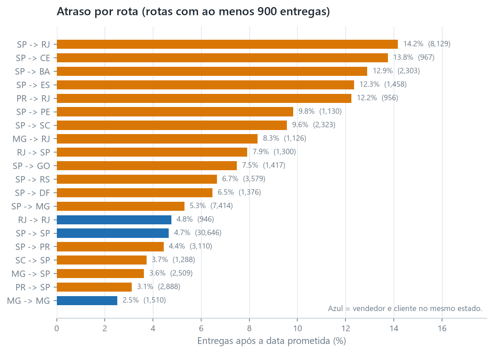

::: {.memo-head}
**Preparado para:** Diretor de Operações<br>
**Preparado por:** Anderson Tavares
:::

> Método, raciocínio completo e limitações estão no
> [relatório 01 · Análise de Varejo](01-business-analytics.qmd).

## Conclusão principal

A entrega atrasada é rara (6.8% das entregas) e é o sinal mais forte de
insatisfação do cliente neste conjunto de dados. Ela não se distribui de forma
uniforme, e não são os vendedores. **O atraso é criado na travessia entre São
Paulo e o Rio, que carrega dois terços dos pedidos do Rio e atrasa 14.2% das
vezes.**

## A descoberta

- **6,535 de 96,476 entregas chegaram depois da data prometida — 6.77%.**
- Um pedido atrasado tem nota média de avaliação de **2.27**; um pedido no prazo
  tem média de **4.29**.
- Depois de uma semana de atraso, **~80% dos clientes dão uma ou duas estrelas**,
  contra 9.27% dos clientes com entrega no prazo.
- São Paulo atrasa em **4.49%** das entregas, o Rio de Janeiro em **12.10%**, a
  Bahia em **12.16%** e o Ceará em **13.76%**.
- **Os vendedores não são a causa.** Os vendedores despacham em cerca de três dias
  em todos os corredores. Um vendedor do Rio entregando dentro do Rio atrasa
  **4.67%** das vezes, igualando os **4.63%** de São Paulo, e 53 dos 65 vendedores
  que enviam para os dois estados vão pior para o Rio.
- **O corredor é a causa.** De São Paulo ao Rio carrega **8,129** das 12,353
  entregas do Rio e atrasa **14.17%**. Todo corredor que fica dentro de um único
  estado fica em 4.8% ou menos.

{#fig-lane fig-align="center"}

{#fig-delivery fig-align="center"}

## Quanto custa

O Rio de Janeiro registrou 12,353 entregas e 1,495 pedidos atrasados, e 8,129
dessas entregas vieram de vendedores de São Paulo. À taxa de atraso de São Paulo,
de 4.49%, cerca de **940 dos 1,495 não teriam chegado atrasados**.

Esperava-se que esses 940 pedidos produzissem cerca de **370 avaliações de uma e
duas estrelas a menos**, aplicando o comportamento observado de avaliação dos
pedidos atrasados (49.36% com nota ≤2) em contraste com os pedidos no prazo
(9.27%).

Isto é uma associação, não uma estimativa causal. Não demonstrei que fazer a
entrega no prazo *causa* a avaliação melhor, apenas que as duas coisas ocorrem
juntas, e, como o conjunto de dados não traz nenhum dado de custo ou margem, nada
disso pode ser convertido em lucro.

## Recomendação

**Trabalhe o corredor de São Paulo ao Rio, e pare de procurar um vendedor ruim.**
Os vendedores despacham no prazo e os próprios vendedores do Rio são pontuais,
então o atraso está nos 9 dias medianos que o pacote passa entre os dois, e nos
379 pedidos que chegam mais de duas semanas depois da promessa. A pergunta para as
transportadoras nesse corredor é por que o nonagésimo percentil é de 31 dias em um
corredor cuja mediana é 12.8.

```{mermaid}
flowchart TB
  A["São Paulo ao Rio<br/>8,129 entregas, 14.17% atrasadas"] --> B{"Os vendedores<br/>causam isso?"}
  B -- "não" --> C["Eles despacham em cerca de três dias<br/>em todos os corredores"]
  C --> D{"É difícil chegar ao Rio?"}
  D -- "não" --> E["Os próprios vendedores do Rio entregam<br/>com 4.67% de atraso"]
  E --> F["A travessia é o problema,<br/>e sua promessa é a mais frágil:<br/>27 dias contra 30.3 para o corredor SP–RS, mais distante"]
```

*A pergunta sobre os vendedores é respondida pelos dados. A pergunta sobre a
transportadora não é, e é a que vale a pena fazer.*

**Segundo, amplie a promessa nesse corredor.** O pacote médio chega **11.18 dias
antes** e 14% do corredor ainda chega atrasado. Três dias a mais na promessa
registrariam **11.60%** em vez de **14.17%**, e sete a mais registrariam
**8.37%**. Ampliar uma promessa move a medição, e não o pacote, então ela pertence
ao lado da pergunta operacional acima, e não no lugar dela.

## O que mudaria minha opinião

- **Se o atraso no corredor de São Paulo ao Rio se concentrasse em poucas
  transportadoras ou poucos armazéns**, ele passaria a ser um problema de
  contrato ou de roteirização, e não um problema de corredor. O conjunto de dados
  não tem identificador de transportadora, então esse teste exige o lado
  operacional, e não outra consulta.
- **Se os clientes com entrega atrasada diferissem sistematicamente** (produtos
  diferentes, tamanhos de cesta diferentes, expectativas diferentes), a diferença
  nas avaliações poderia refletir em parte quem eles são, e não o que aconteceu
  com o pacote. Comparar notas de avaliação dentro da mesma categoria de produto
  e faixa de valor de pedido testaria isso.
- **Se o grupo "nunca entregue" tivesse nota melhor do que o grupo "8–14 dias
  de atraso" por um motivo específico** (reembolsos, comunicação, expectativas),
  então a gestão de expectativas pode importar tanto quanto a velocidade. Os dados
  mostram esse padrão (1.747 contra 1.672); eu não estabeleci por quê.
