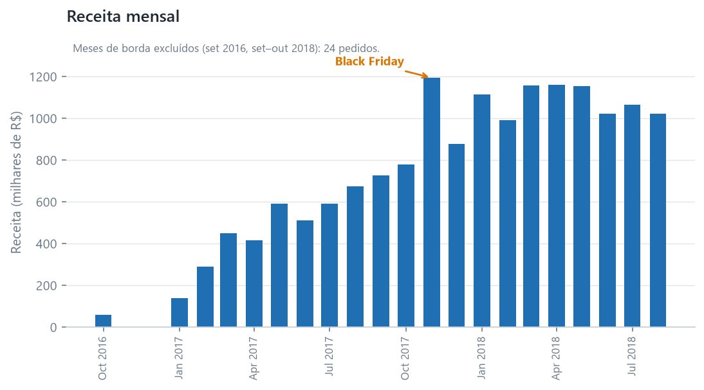
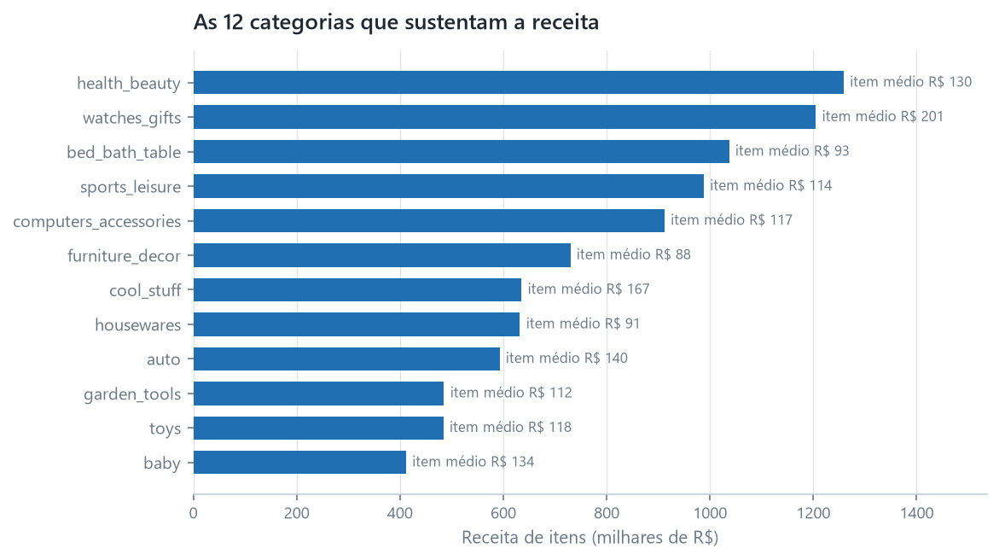
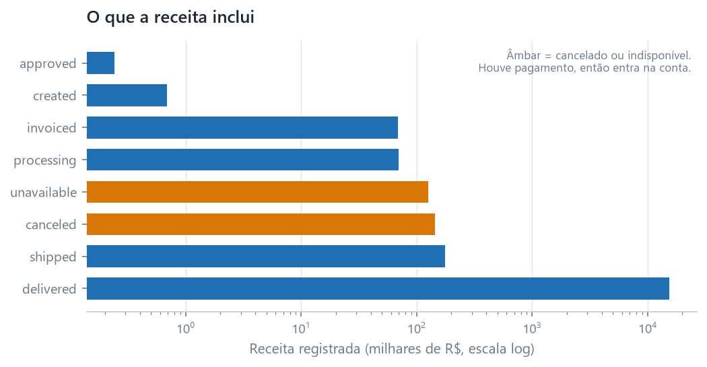
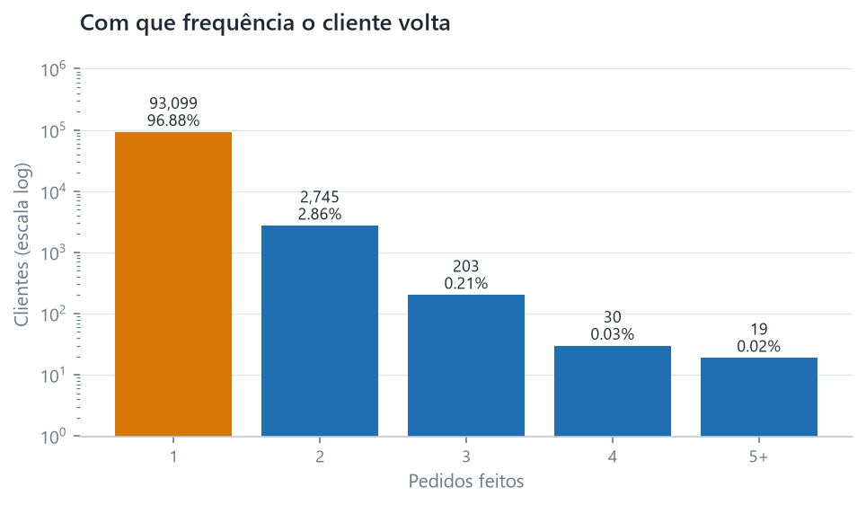
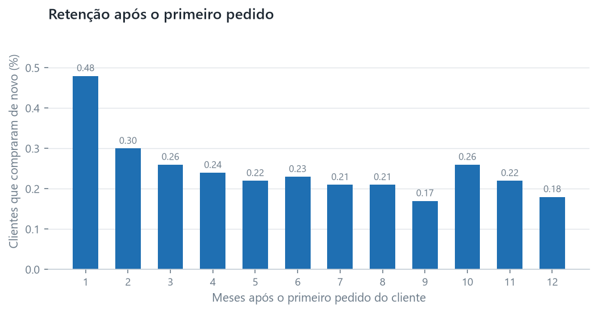
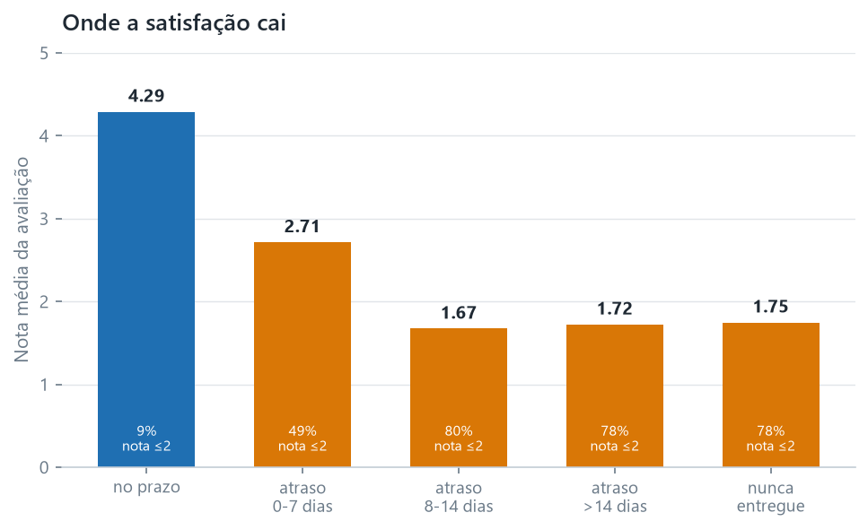
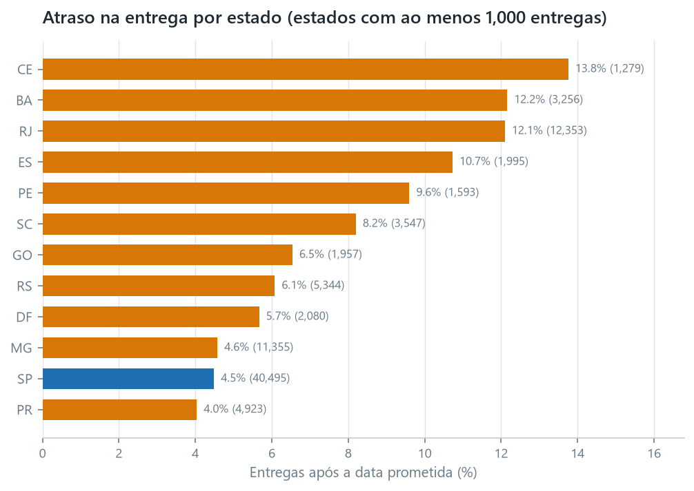

Esta é uma análise do conjunto de dados de e-commerce brasileiro da Olist —
99,441 pedidos feitos entre setembro de 2016 e outubro de 2018 em um marketplace
que conecta vendedores a compradores. Todo número abaixo foi calculado em SQL a
partir dos modelos testados em `projects/01-retail-analytics/dbt_project`, e o
modelo de onde cada tabela vem é nomeado logo abaixo dela.

A pergunta que eu me propus a responder não era "o que aconteceu", mas **quais
alavancas realmente movem a satisfação do cliente e a recompra**. Três respostas
surgiram, e uma delas foi incômoda.

---

## Resumo executivo

> **Sem tempo?** O [memorando de decisão de uma página](00-executive-memo.qmd)
> traz a recomendação e os números por trás dela. Este relatório é o raciocínio.

- **R$ 16.0M passaram pelo marketplace** em 25 meses, em 99,441 pedidos a uma
  média de **R$ 160.99**. O frete é **14.1%** de tudo o que os clientes pagaram.
- **Este é um negócio de aquisição, não de retenção.** De 96,096 clientes,
  **96.9% compraram exatamente uma vez**. A taxa de recompra é **3.1%**, e a
  retenção no primeiro mês é **0.48%**. O crescimento aqui não pode vir de um
  programa de fidelidade, porque quase não há com o que ser fiel.
- **A entrega atrasada é rara e cara.** 93.2% das entregas cumpriram a data
  prometida. Os 6.8% que não cumpriram têm nota média de avaliação de **2.27**,
  contra **4.29** para pedidos no prazo. Além de uma semana de atraso, cerca de
  **80% dos clientes dão uma ou duas estrelas**.
- **O atraso é geográfico e concentrado.** O Rio de Janeiro atrasa em **12.1%**
  das entregas, a Bahia em **12.2%** e o Ceará em **13.8%**, contra **4.5%** de
  São Paulo.
- **A melhoria mais barata disponível está no Rio de Janeiro.** É o segundo maior
  mercado, e cerca de **940 pedidos por ano** não chegariam atrasados se ele
  tivesse o desempenho de São Paulo.

---

## 1. De onde vem a receita

R$ 16,008,872.12 em 99,441 pedidos. O formato ao longo do tempo importa mais do
que o total, porque dois dos vinte e cinco meses não são o que parecem.

```{=html}
<!-- Source: mart_revenue_monthly -->
```

| Mês | Pedidos | Clientes | Receita (R$) | Ticket médio (R$) |
|---|---:|---:|---:|---:|
| 2016-09 | 4 | 4 | 252.24 | 84.08 |
| 2016-10 | 324 | 321 | 59,090.48 | 182.38 |
| 2016-12 | 1 | 1 | 19.62 | 19.62 |
| 2017-01 | 800 | 765 | 138,488.04 | 173.11 |
| 2017-02 | 1,780 | 1,755 | 291,908.01 | 163.99 |
| 2017-03 | 2,682 | 2,642 | 449,863.60 | 167.73 |
| 2017-04 | 2,404 | 2,372 | 417,788.03 | 173.79 |
| 2017-05 | 3,700 | 3,625 | 592,918.82 | 160.25 |
| 2017-06 | 3,245 | 3,180 | 511,276.38 | 157.56 |
| 2017-07 | 4,026 | 3,947 | 592,382.92 | 147.14 |
| 2017-08 | 4,331 | 4,246 | 674,396.32 | 155.71 |
| 2017-09 | 4,285 | 4,212 | 727,762.45 | 169.84 |
| 2017-10 | 4,631 | 4,561 | 779,677.88 | 168.36 |
| **2017-11** | **7,544** | **7,430** | **1,194,882.80** | 158.39 |
| 2017-12 | 5,673 | 5,603 | 878,401.48 | 154.84 |
| 2018-01 | 7,269 | 7,166 | 1,115,004.18 | 153.39 |
| 2018-02 | 6,728 | 6,569 | 992,463.34 | 147.51 |
| 2018-03 | 7,211 | 7,115 | 1,159,652.12 | 160.82 |
| 2018-04 | 6,939 | 6,882 | 1,160,785.48 | 167.28 |
| 2018-05 | 6,873 | 6,814 | 1,153,982.15 | 167.90 |
| 2018-06 | 6,167 | 6,128 | 1,023,880.50 | 166.03 |
| 2018-07 | 6,292 | 6,230 | 1,066,540.75 | 169.51 |
| 2018-08 | 6,512 | 6,460 | 1,022,425.32 | 157.01 |
| 2018-09 | 16 | 14 | 4,439.54 | 277.47 |
| 2018-10 | 4 | 4 | 589.67 | 147.42 |

{#fig-revenue fig-align="center"}

**Dois meses são artefatos, e lê-los como tendência seria um erro.**

As duas últimas linhas não são um colapso. O conjunto de dados termina em 17 de
outubro de 2018, então setembro e outubro são meses parciais — os 16 pedidos de
setembro representam mais ou menos a primeira metade do mês, e os 4 pedidos de
outubro representam dezessete dias de um mês que em grande parte não aconteceu.
O crescimento mês a mês lido nessas linhas não tem sentido.

2016 é o problema oposto: é um lançamento, não um ano tranquilo. Dez pedidos em
três meses e, depois, 324 só em outubro. O negócio efetivamente começa em 2017, e
qualquer comparação ano a ano que comece em 2016 compara uma empresa com uma
empresa que ainda não tinha aberto.

O sinal real está em outro lugar. **Novembro de 2017 é o maior mês do conjunto de
dados** — 7,544 pedidos e R$ 1.19M, 63% acima de outubro —, o que é consistente
com a Black Friday. E 2018 se acomoda em um platô em torno de 6,300–7,300 pedidos
por mês, sem uma tendência forte de crescimento, o que é uma história diferente da
que a linha do topo sugere.

### O que vende

```{=html}
<!-- Source: mart_category_revenue -->
```

| Categoria | Pedidos | Itens | Receita (R$) | Valor médio do item (R$) |
|---|---:|---:|---:|---:|
| health_beauty | 8,836 | 9,670 | 1,258,681.34 | 130.16 |
| watches_gifts | 5,624 | 5,991 | 1,205,005.68 | 201.14 |
| bed_bath_table | 9,417 | 11,115 | 1,036,988.68 | 93.30 |
| sports_leisure | 7,720 | 8,641 | 988,048.97 | 114.34 |
| computers_accessories | 6,689 | 7,827 | 911,954.32 | 116.51 |
| furniture_decor | 6,449 | 8,334 | 729,762.49 | 87.56 |
| cool_stuff | 3,632 | 3,796 | 635,290.85 | 167.36 |
| housewares | 5,884 | 6,964 | 632,248.66 | 90.79 |
| auto | 3,897 | 4,235 | 592,720.11 | 139.96 |
| garden_tools | 3,518 | 4,347 | 485,256.46 | 111.63 |

{#fig-categories fig-align="center"}

São 74 categorias, e as dez principais respondem por **62.4%** da receita de
itens. Os nomes de categoria aparecem como estão no conjunto de dados, porque são
valores de coluna que precisam poder ser encontrados no banco.

**Uma observação sobre por que esses números não somam o total.** A receita por
categoria conta apenas o preço dos itens, e o frete é excluído de propósito: um
mesmo envio costuma levar produtos de várias categorias, e o frete é cobrado uma
única vez pelo pedido inteiro, então não há forma honesta de atribuí-lo. As
categorias, portanto, somam R$ 13.59M contra R$ 16.0M de pagamentos, e **a
diferença é o frete, não um erro**. Dos R$ 2.25M que o frete representa, R$
162,591.95 pertencem a 775 pedidos que têm um pagamento, mas nenhuma linha de item
alguma.

Três das 74 categorias não têm tradução para o inglês na fonte. Elas mantêm seus
nomes em português em vez de serem agrupadas em um balde "unknown", o que as
esconderia.

### O que o valor de receita inclui

Pagamentos não são o mesmo que vendas concluídas. Um pagamento é registrado para
pedidos que depois foram cancelados ou marcados como indisponíveis, então esses
pedidos estão dentro dos R$ 16.0M acima.

{#fig-status fig-align="center"}

Juntos, eles somam R$ 269,735.11 — cerca de 1.7% do total — e são contados de
propósito: o pagamento foi recebido. Excluí-los seria uma definição diferente e
igualmente defensável. Declarar qual delas está em uso aqui significa que um
leitor que discorda pode discordar conscientemente, e não em silêncio.

---

## 2. Quem são os clientes

96,096 pessoas fizeram 99,441 pedidos.

| Pedidos realizados | Clientes | Participação |
|---:|---:|---:|
| 1 | 93,099 | 96.88% |
| 2 | 2,745 | 2.86% |
| 3 | 203 | 0.21% |
| 4 | 30 | 0.03% |
| 5–9 | 18 | 0.02% |
| 17 | 1 | 0.001% |

{#fig-repeat fig-align="center"}

```{=html}
<!-- Source: mart_rfm -->
```

| Segmento | Clientes | Participação | Gasto médio (R$) | Média de dias desde o último pedido |
|---|---:|---:|---:|---:|
| Outros | 27,746 | 28.87% | 142.45 | 235 |
| Em risco (era valioso) | 22,659 | 23.58% | 242.91 | 446 |
| Campeões | 15,880 | 16.53% | 310.04 | 142 |
| Perdidos / baixo valor | 15,427 | 16.05% | 55.16 | 448 |
| Novos / promissores | 14,384 | 14.97% | 54.11 | 140 |

**Não vou fingir que esta segmentação é mais útil do que é.** O RFM funciona
encontrando clientes que compram com frequência — e a frequência quase não varia
aqui: 96.9% dos clientes fizeram exatamente um pedido, então quase todos empatam
em F e a divisão por `ntile` separa essa massa empatada de forma arbitrária. O
que resta é uma segmentação por recência e gasto, na qual "Champions" significa
*comprou recentemente e gastou bem*, não *leal*. Uma campanha de retenção voltada
a esse grupo estaria voltada a compradores de primeira viagem.

Mantive-a mesmo assim, por dois motivos. É a primeira coisa que a maioria dos
stakeholders pede, e seu fracasso aqui **é** a descoberta: não se chega a uma
estratégia de retenção por segmentação em um negócio onde ninguém recompra. A
coluna `f_score` está documentada em `mart_rfm` como quase sem significado
exatamente por isso.

---

## 3. Eles voltam?

**Não.** 2,997 clientes entre 96,096 fizeram um segundo pedido alguma vez — uma
taxa de recompra de **3.12%**. Clientes recorrentes respondem por 6,342 dos
99,441 pedidos, ou **6.4%**.

```{=html}
<!-- Source: mart_cohort_retention -->
```

| Meses após o primeiro pedido | Tamanho da coorte | Ainda ativos | Retenção |
|---:|---:|---:|---:|
| 0 | 96,096 | 96,096 | 100.00% |
| 1 | 95,765 | 461 | 0.48% |
| 2 | 95,764 | 289 | 0.30% |
| 3 | 77,482 | 202 | 0.26% |
| 4 | 76,800 | 186 | 0.24% |
| 5 | 64,149 | 143 | 0.22% |
| 6 | 57,505 | 133 | 0.23% |
| 9 | 37,778 | 65 | 0.17% |
| 12 | 22,317 | 40 | 0.18% |
| 18 | 5,473 | 12 | 0.22% |

{#fig-cohort fig-align="center"}

O mês zero é 100% por construção — é o mês em que o cliente foi adquirido — e um
teste garante isso, porque um offset zero que *não* fosse 100% significaria que a
lógica de coorte está quebrada, e não que o negócio mudou.

O formato é o ponto. A retenção não decai de uma base alta; ela **começa** em
0.48% e permanece estável em torno de 0.2%. Essa não é a curva de um negócio
perdendo clientes. É a curva de um marketplace em que cada compra é quase
independente da anterior.

**Duas ressalvas honestas.** A janela de observação é de 25 meses, então um
cliente que voltaria no terceiro ano é simplesmente invisível aqui — isto é um
piso, não a verdadeira taxa de recompra ao longo da vida. E `customer_unique_id`
é um identificador derivado, então uma pessoa que altere seus dados pode aparecer
duas vezes, o que infla ligeiramente a contagem em vez de reduzi-la.

**O que isto significa estrategicamente.** Se 96.9% da receita vem de primeiros
pedidos, o crescimento é um problema de aquisição, não de retenção. Um programa
de fidelidade gastaria dinheiro para influenciar uma decisão que 96.9% dos
clientes hoje não estão tomando. As duas alavancas que existem de fato são
adquirir mais clientes e elevar o valor dos pedidos — e elevar o valor dos pedidos
sem recompra significa aumentar o tamanho da cesta por visita.

---

## 4. O desempenho das entregas explica a satisfação?

Esta é a relação mais forte do conjunto de dados.

6,535 de 96,476 entregas chegaram depois da data prometida — **6.77%**.

```{=html}
<!-- Source: mart_delivery_performance -->
```

| Resultado | Pedidos | Participação | Nota média | Avaliações ≤2 | Entrega média (dias) |
|---|---:|---:|---:|---:|---:|
| No prazo | 89,941 | 90.45% | **4.290** | 9.27% | 11.00 |
| Atrasado: até 7 dias | 3,672 | 3.69% | 2.715 | 49.36% | 25.73 |
| Atrasado: 8 a 14 dias | 1,479 | 1.49% | 1.672 | 80.10% | 35.03 |
| Atrasado: mais de 14 dias | 1,384 | 1.39% | 1.723 | 78.35% | 54.62 |
| Nunca entregue | 2,965 | 2.98% | 1.747 | 78.05% | — |

{#fig-delivery fig-align="center"}

Agregando, um pedido atrasado tem média de **2.27** contra **4.29** de um pedido
no prazo. Isso não é uma diferença de arredondamento; é a diferença entre um
cliente amplamente satisfeito e um que não está.

**Um resultado dessa tabela me surpreendeu.** Um pedido que nunca chegou tem nota
**1.747**, que é *melhor* do que a de um pedido que chegou de oito a quatorze dias
atrasado (**1.672**). A pior experiência da tabela não é o pacote que sumiu.

A explicação provável é que se trata de situações diferentes, e não de gravidades
diferentes. Um pedido cancelado ou indisponível é um evento **encerrado** —
geralmente reembolsado e, muitas vezes, comunicado. Um pedido que só aparece 35
dias atrasado não está encerrado: o cliente esperou e ainda teve de lidar com o
produto. Eu gostaria de testar isso antes de agir com base nisso, e não testei,
então o relato como observação, e não como conclusão.

### Onde está o atraso

```{=html}
<!-- Source: mart_late_delivery_by_state -->
```

| Estado | Entregas | Atrasos | Taxa de atraso | Entrega média (dias) | Nota média |
|---|---:|---:|---:|---:|---:|
| SP | 40,495 | 1,820 | **4.49%** | 8.76 | 4.173 |
| RJ | 12,353 | 1,495 | **12.10%** | 15.31 | 3.878 |
| MG | 11,355 | 520 | 4.58% | 12.01 | 4.135 |
| RS | 5,344 | 325 | 6.08% | 15.30 | 4.132 |
| PR | 4,923 | 199 | 4.04% | 11.99 | 4.182 |
| SC | 3,547 | 291 | 8.20% | 14.96 | 4.074 |
| BA | 3,256 | 396 | **12.16%** | 19.34 | 3.861 |
| CE | 1,279 | 176 | **13.76%** | 21.27 | 3.857 |

{#fig-late fig-align="center"}

O atraso não é aleatório pelo país. São Paulo — 42% de todas as entregas — atrasa
4.49% das vezes e entrega em 8.76 dias. O Ceará atrasa 13.76% das vezes e leva
21.27 dias. A correlação entre distância e atraso é visível nos próprios prazos de
entrega.

**O Rio de Janeiro é o caso acionável.** É o segundo maior mercado, com 12,353
entregas, e atrasa **2.7×** mais do que São Paulo. Se o Rio tivesse o desempenho
de São Paulo, cerca de **940 de seus 1,495 pedidos atrasados não estariam
atrasados**. Aplicando o comportamento de avaliação dos pedidos atrasados (49.36%
com nota ≤2) em contraste com os pedidos no prazo (9.27%), isso equivale a cerca
de **370 avaliações de uma e duas estrelas a menos por ano** só do Rio.

Essa estimativa é uma associação, não uma previsão causal — não demonstrei que
fazer a entrega no prazo *causa* a avaliação melhor, apenas que as duas andam
juntas, e os clientes que passam por entrega atrasada podem diferir em outros
aspectos. Eu trataria o número como um motivo para investigar, não como um caso
de negócio para um gasto específico.

---

## O que eu faria em seguida

1. **Investigue primeiro o corredor do Rio de Janeiro.** É o maior conjunto de
   insatisfação recuperável do conjunto de dados, é concentrado o suficiente para
   ser estudado, e o contrafactual é testável: compare pedidos do Rio atendidos
   por vendedores ou transportadoras diferentes no mesmo período.
2. **Reexamine a própria promessa de entrega.** As estimativas da Olist são
   extremamente conservadoras — a entrega média chega **11.18 dias antes**, e
   93.2% dos pedidos chegam no prazo. Uma promessa que é batida quase sempre não é
   necessariamente boa: ela pode estar custando conversões, e um cliente a quem se
   diz "em até 25 dias" e que recebe em 12 teve uma experiência pior do que um a
   quem se diz "em 12". Encurtar a promessa trocaria uma taxa de atraso medida
   maior por expectativas mais bem calibradas, e vale a pena quantificar essa
   troca em vez de presumi-la.
3. **Teste o resultado do pacote que sumiu.** Um pedido que nunca chegou recebeu
   nota melhor do que um que chegou duas semanas atrasado. Isso é ou uma diferença
   real na forma como as duas falhas são tratadas, ou um artefato de quem decide
   avaliar, e é testável com os dados já carregados. Até ser testado, eu o relato
   como observação, não como conclusão.
4. **Alimente o Projeto 02.** Os grupos de entrega são o alvo natural do modelo
   de previsão de entregas atrasadas, e a restrição já está clara: só podem ser
   usadas variáveis conhecidas no momento da compra.

---

## Limitações

Elas são declaradas antes de os números serem usados, e não depois, porque moldam
como os números devem ser lidos:

- **O conjunto de dados é um recorte de setembro de 2016 a outubro de 2018, não
  um fluxo ao vivo.** Setembro e outubro de 2018 são parciais. Qualquer coisa
  descrita aqui é uma observação de um período, não uma tendência.
- **As avaliações são autosselecionadas.** Só aparecem os clientes que optaram por
  deixar uma avaliação — 98,673 de 99,441 pedidos. A satisfação deles não é a da
  população, e uma média de 4.29 entre os respondentes não é uma média de 4.29
  entre os clientes.
- **"Receita" significa valor bruto de mercadorias** conforme registrado na tabela
  de pagamentos. Não há dados de custo, margem, reembolso ou devolução neste
  conjunto de dados, então nenhuma afirmação sobre lucro é possível — apenas sobre
  dinheiro recebido.
- **A receita inclui pedidos posteriormente cancelados ou marcados como
  indisponíveis** (1,234 pedidos, R$ 269,735.11 — as duas barras âmbar em
  @fig-status), porque um pagamento foi registrado para eles. Excluí-los seria uma
  definição diferente e igualmente defensável; esta é declarada para que o leitor
  possa discordar dela conscientemente.
- **`customer_unique_id` é derivado e imperfeito.** As conclusões sobre recompra
  são um piso, não um teto.
- **Contagens de pedidos e contagens de itens são granularidades diferentes.**
  Tudo sobre produtos ou categorias vem de `fct_order_items`; tudo sobre dinheiro,
  entrega ou avaliação vem de `fct_orders`. Misturá-los é a forma mais provável de
  produzir um total errado.
- **Onde faltam carimbos de data e hora de entrega** (2,965 pedidos), esses
  pedidos são excluídos das estatísticas de entrega em vez de imputados, e
  mantidos como um grupo próprio onde o assunto é a experiência do cliente.

---

## Como reproduzir isto

Toda tabela acima vem de um modelo em
`projects/01-retail-analytics/dbt_project`:

| Tabela | Modelo |
|---|---|
| Receita por mês | `mart_revenue_monthly` |
| Receita por categoria | `mart_category_revenue` |
| Segmentos de clientes | `mart_rfm` |
| Retenção por coorte | `mart_cohort_retention` |
| Resultados de entrega | `mart_delivery_performance` |
| Atrasos por estado | `mart_late_delivery_by_state` |

### Como a tabela de pedidos é construída

A decisão de engenharia mais importante desta análise é que a tabela no nível do
pedido é montada **agregando três tabelas de granularidade mais fina antes de
juntá-las**, em vez de juntá-las diretamente.

```{mermaid}
flowchart TB
  O["orders<br/>99,441 linhas"]
  subgraph fine["tabelas de granularidade mais fina"]
    I["order_items<br/>112,650 linhas"]
    P["order_payments<br/>103,886 linhas"]
    R["order_reviews<br/>99,224 linhas"]
  end
  I --> AGG["agregar para uma linha por pedido<br/>soma, contagem, última avaliação"]
  P --> AGG
  R --> AGG
  AGG --> FO["fct_orders<br/>99,441 linhas"]
  O --> FO
  FO --> Q["todos os totais deste relatório"]
```

*Agregue primeiro, depois junte. Uma junção direta multiplica linhas, e nada dá
erro.*

Uma junção direta multiplicaria linhas: um pedido com quatro itens e três
pagamentos contribuiria com doze linhas para cada contagem e com doze vezes seu
valor para cada soma. Todo número deste relatório estaria errado, o SQL
compilaria e o build passaria. Há um registro escrito dessa decisão, e da
peculiaridade de avaliação que ela revelou, em `docs/decisions/`.

### Do espelho até a página

```{mermaid}
flowchart TB
  M["espelho do Hugging Face<br/>revisão fixada"] --> D["download_data.py"]
  D --> CSV["9 arquivos CSV<br/>~126 MB, nunca versionados"]
  CSV --> L["load_raw.py<br/>toda coluna TEXT"]
  L --> DB[("PostgreSQL<br/>schema: raw")]
  DB --> S["dbt staging<br/>views — cast e renomeação"]
  S --> F["dbt marts<br/>tabelas — 70 testes de dados"]
  F --> C["make_charts.py"]
  C --> FIG["figuras PNG"]
  F --> REP["relatório Quarto"]
  FIG --> REP
```

*Apenas os três passos até `dbt marts` precisam de um banco de dados. O relatório
e as figuras são versionados, então o site é construído sem um.*

```bash
uv run python tasks.py setup      # start the database and fetch the data
uv run python tasks.py pipeline   # load, build, charts, test, render
```

`dbt build` também executa 70 testes de dados, incluindo um que garante que a
retenção do mês zero é exatamente 100% e outro que garante que o sinalizador de
atraso e o número de dias de atraso não podem discordar. Ambos existem porque já
estiveram errados uma vez.
