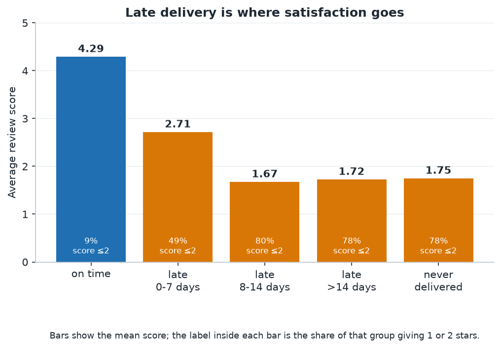

**Prepared for:** Head of Operations<br>
**Prepared by:** Anderson Tavares

> Full reasoning, method and limitations: the
> [01 · Retail Analytics report](01-business-analytics.qmd).

## Bottom line

Late delivery is rare (6.8% of deliveries) and is the single strongest signal of
customer dissatisfaction in this dataset. It is concentrated in a few states
rather than spread evenly, which makes it fixable in principle. **Rio de Janeiro
is the largest, cheapest opportunity.**

## The finding

- **6,535 of 96,476 deliveries arrived after the promised date — 6.77%.**
- A late order averages a review score of **2.27**; an on-time order averages
  **4.29**.
- Past a week late, **~80% of customers give one or two stars**, against 9.27%
  of on-time customers.
- Lateness is geographic. São Paulo: **4.49%**. Rio de Janeiro: **12.10%**.
  Bahia: **12.16%**. Ceará: **13.76%**.

{#fig-delivery fig-align="center"}

## What it costs

Rio de Janeiro recorded 12,353 deliveries and 1,495 late orders. At São Paulo's
4.49% late rate, roughly **940 of those would not have been late**.

Those 940 orders would have been expected to produce about **370 fewer one- and
two-star reviews** — applying the observed review behaviour of late orders
(49.36% scoring ≤2) against on-time orders (9.27%).

This is an association, not a causal estimate. I have not shown that making a
delivery on time causes the better review, only that the two occur together. It
is a reason to investigate Rio, not a business case for a specific spend — and
because the dataset carries no cost or margin data, none of this can be
converted into profit.

## Recommendation

**Investigate the Rio de Janeiro delivery corridor before buying anything.**
Specifically: compare Rio orders handled by different sellers or carriers over
the same period. If lateness in Rio tracks particular sellers rather than the
state itself, the fix is a seller conversation; if it tracks carriers, it is a
contract conversation. The dataset can answer that question, and the answer
determines which conversation to have.

```{mermaid}
flowchart TB
  A["Rio de Janeiro<br/>12.10% late, against São Paulo's 4.49%"] --> B{"Does the lateness<br/>concentrate in a few sellers?"}
  B -- "yes" --> C["Seller conversation<br/>handling time and stock"]
  B -- "no" --> D{"Does it concentrate<br/>in particular carriers?"}
  D -- "yes" --> E["Contract conversation<br/>carrier service levels in the corridor"]
  D -- "no" --> F["Structural — distance, routing,<br/>or which warehouse ships it"]
```

*The question the dataset can answer, and the conversation each answer implies.*

**Second, revisit the delivery promise.** The average delivery arrives **11.18
days before** the estimate. A promise that is beaten almost every time is not
free: it may be suppressing conversion at checkout. Tightening the window would
raise the measured late rate while improving the customer's actual experience,
and that trade should be quantified deliberately rather than left at a default
nobody chose.

## What would change my mind

- **If Rio's lateness concentrated in a few sellers**, the finding stops being
  regional and becomes a seller-quality problem — a different and cheaper fix.
- **If late-delivery customers differ systematically** (different products,
  different basket sizes, different expectations), the review gap may partly
  reflect who they are rather than what happened to their parcel. Comparing
  review scores within the same product category and order value would test
  this.
- **If the "never delivered" group scores better than the "8–14 days late"
  group for a specific reason** — refunds, communication, expectations — then
  the mechanism worth improving is expectation management, not only speed. The
  data shows this pattern (1.747 against 1.672); I have not established why.
