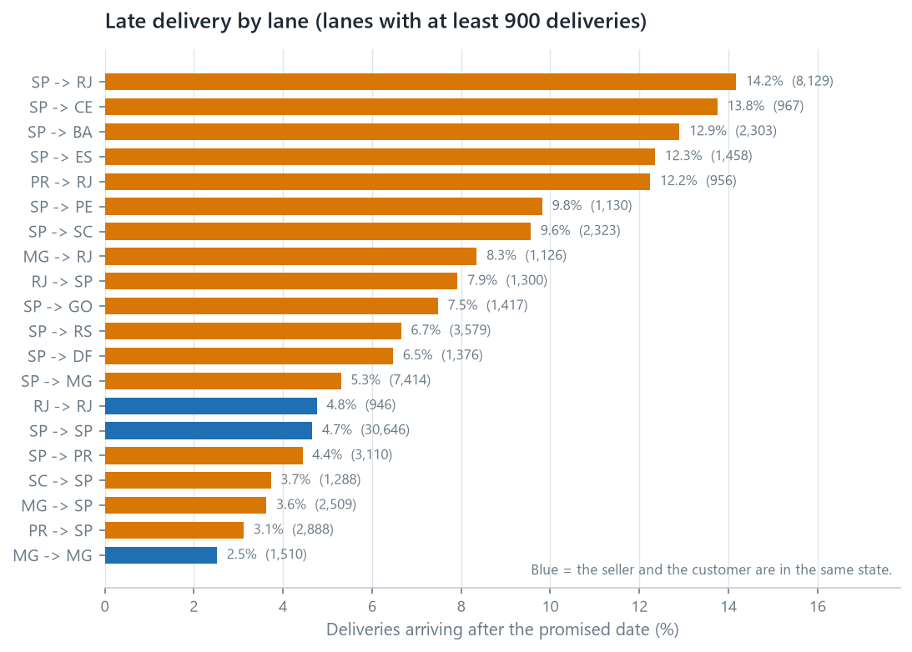

::: {.memo-head}
**Prepared for:** Head of Operations<br>
**Prepared by:** Anderson Tavares
:::

> Method, full reasoning and limitations are in the
> [01 · Retail Analytics report](01-business-analytics.qmd).

## Bottom line

Late delivery is rare (6.8% of deliveries) and is the strongest signal of
customer dissatisfaction in this dataset. It is not spread evenly and it is not
the sellers. **The delay is created in the crossing between São Paulo and Rio,
which carries two thirds of Rio's orders and is late 14.2% of the time.**

## The finding

- **6,535 of 96,476 deliveries arrived after the promised date, 6.77%.**
- A late order averages a review score of **2.27**; an on-time order averages
  **4.29**.
- Past a week late, **~80% of customers give one or two stars**, against 9.27%
  of on-time customers.
- São Paulo is late on **4.49%** of deliveries, Rio de Janeiro on **12.10%**,
  Bahia on **12.16%** and Ceará on **13.76%**.
- **The sellers are not the cause.** Sellers dispatch in about three days on
  every lane. A Rio seller delivering inside Rio is late **4.67%** of the time,
  matching São Paulo's **4.63%**, and 53 of the 65 sellers that ship to both
  states are worse into Rio.
- **The lane is the cause.** São Paulo to Rio carries **8,129** of Rio's 12,353
  deliveries and is late **14.17%**. Every lane that stays inside one state sits
  at 4.8% or below.

{#fig-lane fig-align="center"}

{#fig-delivery fig-align="center"}

## What it costs

Rio de Janeiro recorded 12,353 deliveries and 1,495 late orders, and 8,129 of
those deliveries came from São Paulo sellers. At São Paulo's 4.49% late rate,
roughly **940 of the 1,495 would not have been late**.

Those 940 orders would have been expected to produce about **370 fewer one- and
two-star reviews**, applying the observed review behaviour of late orders
(49.36% scoring ≤2) against on-time orders (9.27%).

This is an association, not a causal estimate. I have not shown that making a
delivery on time causes the better review, only that the two occur together, and
because the dataset carries no cost or margin data, none of this can be converted
into profit.

## Recommendation

**Work the São Paulo to Rio lane, and stop looking for a bad seller.** The
sellers dispatch on schedule and Rio's own sellers are punctual, so the delay is
in the 9 median days the parcel spends between the two, and in the 379 orders
that arrive more than two weeks after the promise. The question for the carriers
on that corridor is why the ninetieth percentile is 31 days on a lane whose
median is 12.8.

```{mermaid}
flowchart TB
  A["São Paulo to Rio<br/>8,129 deliveries, 14.17% late"] --> B{"Do the sellers<br/>cause it?"}
  B -- "no" --> C["They dispatch in about three days<br/>on every lane"]
  C --> D{"Is Rio hard to reach?"}
  D -- "no" --> E["Rio's own sellers deliver<br/>late 4.67% of the time"]
  E --> F["The crossing is the problem,<br/>and its promise is the thinnest:<br/>27 days against 30.3 for the farther SP to RS lane"]
```

*The seller question is answered by the data. The carrier question is not, and
it is the one worth asking.*

**Second, widen the promise on that lane.** The average parcel arrives **11.18
days early** and 14% of the lane is still late. Three more days on the promise
would report **11.60%** instead of **14.17%**, and seven more would report
**8.37%**. Widening a promise moves the measurement rather than the parcel, so
it belongs alongside the operational question above, not instead of it.

## What would change my mind

- **If the lateness on the São Paulo to Rio lane concentrated in a few carriers
  or a few warehouses**, it would become a contract or a routing problem rather
  than a corridor problem. The dataset has no carrier identifier, so that test
  needs the operational side rather than another query.
- **If late-delivery customers differ systematically** (different products,
  different basket sizes, different expectations), the review gap may partly
  reflect who they are rather than what happened to their parcel. Comparing
  review scores within the same product category and order value would test
  this.
- **If the "never delivered" group scores better than the "8–14 days late"
  group for a specific reason** (refunds, communication, expectations), then
  expectation management may matter as much as speed. The data shows the pattern
  (1.747 against 1.672); I have not established why.
