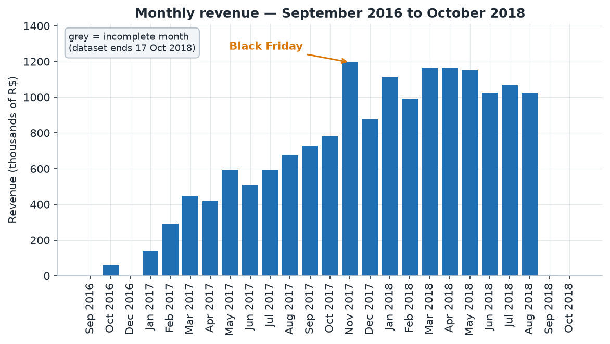
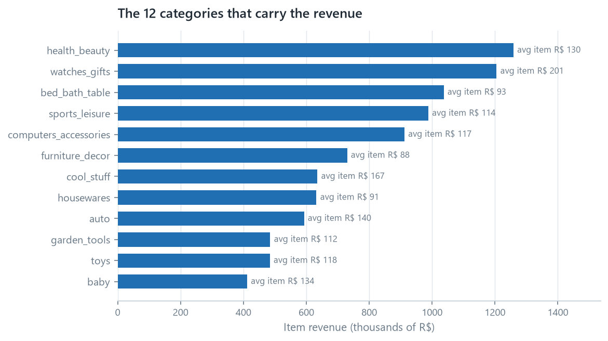
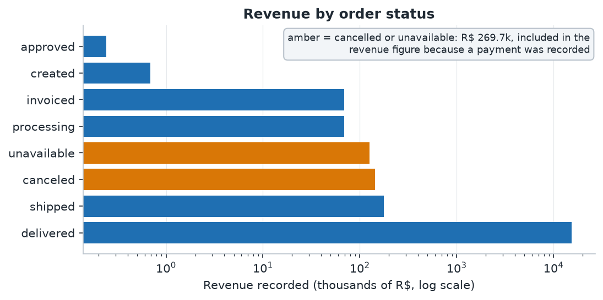
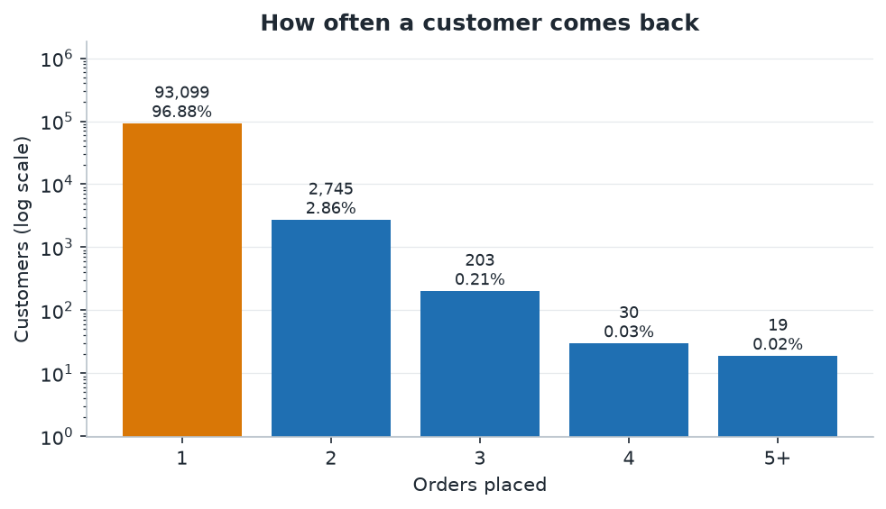
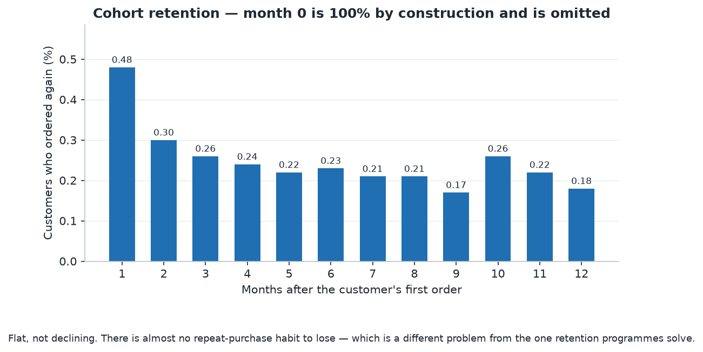
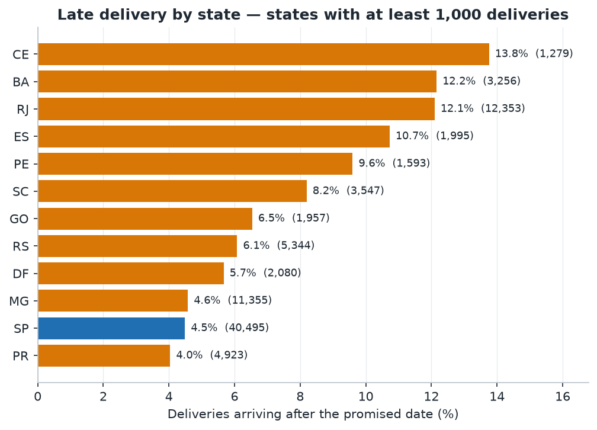

This is an analysis of the Olist Brazilian e-commerce dataset: 99,441 orders
placed between September 2016 and October 2018 on a marketplace that connects
sellers to buyers. Every number below was computed in SQL from the tested models
in `projects/01-retail-analytics/dbt_project`, and the model each table comes
from is named underneath it.

The question was **which levers actually move customer satisfaction and repeat
purchase**, rather than what happened. Three findings came out of it, and the
one about repeat purchase was uncomfortable.

---

## Executive summary

> **Short on time?** The [one-page decision memo](00-executive-memo.qmd) carries
> the recommendation and the numbers behind it. This report is the reasoning.

- **R$ 16.0M passed through the marketplace** in 25 months, across 99,441 orders
  at an average of **R$ 160.99**. Freight is **14.1%** of everything customers
  paid.
- **This is an acquisition business, not a retention business.** Of 96,096
  customers, **96.9% bought exactly once**. The repeat rate is **3.1%**, and
  month-one retention is **0.48%**. Growth here cannot come from a loyalty
  programme, because there is almost nothing to be loyal with.
- **Late delivery is rare and expensive.** 93.2% of deliveries met the promised
  date. The 6.8% that did not average a review score of **2.27**, against
  **4.29** for on-time orders. Beyond a week late, roughly **80% of customers
  give one or two stars**.
- **The delay is a property of one lane, not of the places or the sellers.** Rio
  de Janeiro is late on **12.1%** of deliveries and Ceará on **13.8%**, against
  São Paulo's **4.5%**. But a Rio seller delivering inside Rio matches São Paulo
  (**4.7%** against **4.6%**), and 53 of the 65 sellers who ship to both states
  are worse into Rio. The delay is created in the crossing between São Paulo and
  Rio, which carries two thirds of Rio's orders at **14.2%** late.
- **That lane carries the thinnest promise in the dataset.** São Paulo to Rio is
  promised 27 days against 30.3 for the farther São Paulo to Rio Grande do Sul
  lane, and its tail is heavier. Three more days on the promise would report
  **11.6%** instead of **14.2%**, and seven more would report **8.4%**. The
  average parcel on the lane arrives **10.9 days early**, so the promise is not
  what makes deliveries late, it is why so much of the lateness is recorded.

---

## 1. Where the revenue comes from

R$ 16,008,872.12 across 99,441 orders. The shape over time matters more than the
total, because two of the twenty-five months are not what they look like.

```{=html}
<!-- Source: mart_revenue_monthly -->
```

| Month | Orders | Customers | Revenue (R$) | Avg order (R$) |
|---|---:|---:|---:|---:|
| 2016-09 | 4 | 4 | 252.24 | 84.08 |
| 2016-10 | 324 | 321 | 59,090.48 | 182.38 |
| 2016-12 | 1 | 1 | 19.62 | 19.62 |
| 2017-01 | 800 | 765 | 138,488.04 | 173.11 |
| 2017-02 | 1,780 | 1,755 | 291,908.01 | 163.99 |
| 2017-03 | 2,682 | 2,642 | 449,863.60 | 167.73 |
| 2017-04 | 2,404 | 2,372 | 417,788.03 | 173.79 |
| 2017-05 | 3,700 | 3,625 | 592,918.82 | 160.25 |
| 2017-06 | 3,245 | 3,180 | 511,276.38 | 157.56 |
| 2017-07 | 4,026 | 3,947 | 592,382.92 | 147.14 |
| 2017-08 | 4,331 | 4,246 | 674,396.32 | 155.71 |
| 2017-09 | 4,285 | 4,212 | 727,762.45 | 169.84 |
| 2017-10 | 4,631 | 4,561 | 779,677.88 | 168.36 |
| **2017-11** | **7,544** | **7,430** | **1,194,882.80** | 158.39 |
| 2017-12 | 5,673 | 5,603 | 878,401.48 | 154.84 |
| 2018-01 | 7,269 | 7,166 | 1,115,004.18 | 153.39 |
| 2018-02 | 6,728 | 6,569 | 992,463.34 | 147.51 |
| 2018-03 | 7,211 | 7,115 | 1,159,652.12 | 160.82 |
| 2018-04 | 6,939 | 6,882 | 1,160,785.48 | 167.28 |
| 2018-05 | 6,873 | 6,814 | 1,153,982.15 | 167.90 |
| 2018-06 | 6,167 | 6,128 | 1,023,880.50 | 166.03 |
| 2018-07 | 6,292 | 6,230 | 1,066,540.75 | 169.51 |
| 2018-08 | 6,512 | 6,460 | 1,022,425.32 | 157.01 |
| 2018-09 | 16 | 14 | 4,439.54 | 277.47 |
| 2018-10 | 4 | 4 | 589.67 | 147.42 |

{#fig-revenue fig-alt="Column chart of monthly revenue for every month the marketplace was trading, from late 2016 to mid 2018. Revenue climbs to a peak in November 2017 and then flattens at a slightly lower level through 2018." fig-align="center"}

**Two months are artefacts, and reading them as a trend would be a mistake.**

The last two rows are not a collapse. The dataset ends on 17 October 2018, so
September and October are partial months. September's 16 orders represent
roughly the first half of the month, and October's 4 orders represent
seventeen days of a month that mostly did not happen. Month-over-month growth
read from those rows is meaningless.

2016 has the opposite problem: it is a launch rather than a quiet year. Ten
orders across three months, then 324 in October alone. The business effectively
starts in 2017, and any year-over-year comparison that begins in 2016 is
comparing a company to a company that had not opened yet.

**November 2017 is the largest month in the dataset**, with 7,544 orders and
R$ 1.19M, 63% above October. That is consistent with Black Friday. And 2018 settles into a plateau around 6,300–7,300 orders a
month with no strong growth trend, which is a different story from the one the
top line suggests.

### What sells

```{=html}
<!-- Source: mart_category_revenue -->
```

| Category | Orders | Items | Revenue (R$) | Avg item (R$) |
|---|---:|---:|---:|---:|
| health_beauty | 8,836 | 9,670 | 1,258,681.34 | 130.16 |
| watches_gifts | 5,624 | 5,991 | 1,205,005.68 | 201.14 |
| bed_bath_table | 9,417 | 11,115 | 1,036,988.68 | 93.30 |
| sports_leisure | 7,720 | 8,641 | 988,048.97 | 114.34 |
| computers_accessories | 6,689 | 7,827 | 911,954.32 | 116.51 |
| furniture_decor | 6,449 | 8,334 | 729,762.49 | 87.56 |
| cool_stuff | 3,632 | 3,796 | 635,290.85 | 167.36 |
| housewares | 5,884 | 6,964 | 632,248.66 | 90.79 |
| auto | 3,897 | 4,235 | 592,720.11 | 139.96 |
| garden_tools | 3,518 | 4,347 | 485,256.46 | 111.63 |

{#fig-categories fig-alt="Horizontal bar chart of the twelve categories with the most item revenue, ordered best first, each bar labelled with its average item price. Health and beauty leads, followed by watches and gifts and by bed, bath and table." fig-align="center"}

There are 74 categories, and the top ten account for **62.4%** of item revenue.

**A note on why these numbers do not add up to the total.** Category revenue
counts item price only, and freight is excluded deliberately: one shipment often
carries products from several categories, and freight is charged once for the
whole order, so there is no honest way to attribute it. Categories therefore sum
to R$ 13.59M against R$ 16.0M of payments, and **the gap is freight, not a
mistake**. Of the R$ 2.25M that freight represents, R$ 162,591.95 belongs to 775
orders that carry a payment but no item line at all.

Three of the 74 categories have no English translation in the source. They keep
their Portuguese names rather than being folded into an "unknown" bucket, which
would hide them.

### What the revenue figure includes

Payments are not the same as completed sales. A payment is recorded for orders
that were later cancelled or marked unavailable, so those orders sit inside the
R$ 16.0M above.

{#fig-status fig-alt="Horizontal bar chart of revenue by order status on a logarithmic scale. Delivered orders account for almost all of it; the bars for cancelled and unavailable orders are drawn in amber." fig-align="center"}

Together they are R$ 269,735.11, about 1.7% of the total, and they are counted
deliberately: the payment was collected. Excluding them would be a different and
equally defensible definition. Stating which one is in use here means a reader
who disagrees can disagree knowingly rather than silently.

---

## 2. Who the customers are

96,096 people made 99,441 orders.

| Orders placed | Customers | Share |
|---:|---:|---:|
| 1 | 93,099 | 96.88% |
| 2 | 2,745 | 2.86% |
| 3 | 203 | 0.21% |
| 4 | 30 | 0.03% |
| 5–9 | 18 | 0.02% |
| 17 | 1 | 0.001% |

{#fig-repeat fig-alt="Bar chart on a logarithmic scale of how many orders each customer placed. Almost every customer placed exactly one order, and that bar dwarfs every other bar." fig-align="center"}

```{=html}
<!-- Source: mart_rfm -->
```

| Segment | Customers | Share | Avg spend (R$) | Avg days since last order |
|---|---:|---:|---:|---:|
| Others | 27,746 | 28.87% | 142.45 | 235 |
| At risk (was valuable) | 22,659 | 23.58% | 242.91 | 446 |
| Champions | 15,880 | 16.53% | 310.04 | 142 |
| Lost / low value | 15,427 | 16.05% | 55.16 | 448 |
| New / promising | 14,384 | 14.97% | 54.11 | 140 |

**I am not going to pretend this segmentation is more useful than it is.** RFM
works by finding customers who buy often, and frequency barely varies here:
96.9% of customers ordered exactly once, so almost everyone ties on F and the
`ntile` split separates that tied mass arbitrarily. What remains is a
segmentation on recency and spend, in which "Champions" means *bought recently
and spent well*, not *loyal*. A retention campaign aimed at that group would be
aimed at first-time buyers.

I kept it anyway, for two reasons. It is the first thing most stakeholders ask
for, and its failure here is the finding: you cannot segment your way into a
retention strategy for a business where nobody repeats. The `f_score` column is
documented in `mart_rfm` as close to meaningless for exactly this reason.

---

## 3. Do they come back?

2,997 of 96,096 customers ever placed a second order, a repeat rate of **3.12%**.
Repeat customers account for 6,342 of 99,441 orders, or **6.4%**.

```{=html}
<!-- Source: mart_cohort_retention -->
```

| Months after first order | Cohort size | Still active | Retention |
|---:|---:|---:|---:|
| 0 | 96,096 | 96,096 | 100.00% |
| 1 | 95,765 | 461 | 0.48% |
| 2 | 95,764 | 289 | 0.30% |
| 3 | 77,482 | 202 | 0.26% |
| 4 | 76,800 | 186 | 0.24% |
| 5 | 64,149 | 143 | 0.22% |
| 6 | 57,505 | 133 | 0.23% |
| 9 | 37,778 | 65 | 0.17% |
| 12 | 22,317 | 40 | 0.18% |
| 18 | 5,473 | 12 | 0.22% |

{#fig-cohort fig-alt="Column chart of the share of each monthly cohort that ordered again, by months since the first order. Every column is below half a percent, so the series is flat rather than falling." fig-align="center"}

Month zero is 100% by construction, because it is the month the customer was
acquired. A test asserts it: an offset zero that is *not* 100% means the cohort
logic is broken, not that the business changed.

Retention does not decay from a high base. It **starts** at 0.48% and stays flat
at roughly 0.2%, which is the curve of a marketplace where each purchase is
close to independent of the last.

**Two caveats.** The observation window is 25 months, so a customer who
would return in year three is simply invisible here. This is a floor, not the
true lifetime repeat rate. And `customer_unique_id` is a derived identifier, so
a person who changes their details may appear twice, which inflates the count
slightly rather than deflating it.

**What this means strategically.** If 96.9% of revenue comes from first orders,
growth has to come from acquiring customers. A loyalty programme would spend
money to influence a decision that 96.9% of customers are not currently making.
The two levers that exist are acquiring more customers and raising order value,
and without repeat purchase, raising order value means raising basket size per
visit.

---

## 4. Does delivery performance explain satisfaction?

This is the strongest relationship in the dataset.

6,535 of 96,476 deliveries arrived after the promised date, **6.77%**.

```{=html}
<!-- Source: mart_delivery_performance -->
```

| Outcome | Orders | Share | Avg review | Reviews ≤2 | Avg delivery (days) |
|---|---:|---:|---:|---:|---:|
| On time | 89,941 | 90.45% | **4.290** | 9.27% | 11.00 |
| Late: up to 7 days | 3,672 | 3.69% | 2.715 | 49.36% | 25.73 |
| Late: 8 to 14 days | 1,479 | 1.49% | 1.672 | 80.10% | 35.03 |
| Late: more than 14 days | 1,384 | 1.39% | 1.723 | 78.35% | 54.62 |
| Never delivered | 2,965 | 2.98% | 1.747 | 78.05% | — |

{#fig-delivery fig-alt="Bar chart of the mean review score by delivery outcome, from the on-time group down to orders that arrived more than two weeks late and orders that never arrived. The share of each group scoring one or two is printed inside its bar and is several times higher for every late group." fig-align="center"}

Aggregated, a late order averages **2.27** against **4.29** for an on-time one.
That gap is the difference between a broadly satisfied customer and one who is
not.

**One result in that table surprised me.** An order that never arrived scores
**1.747**, which is *better* than an order that arrived eight to fourteen days
late (**1.672**). The worst experience in the table is not the missing parcel.

The likely explanation is that these are different situations rather than
different severities. A cancelled or unavailable order is a **closed** event,
usually refunded and often communicated. An order that turns up 35 days late is
not closed: the customer waited, and then still had to deal with the product. I
would want to test that before acting on it, and I have not, so I am reporting
it as an observation rather than a finding.

### Where the lateness is

```{=html}
<!-- Source: mart_late_delivery_by_state -->
```

| State | Deliveries | Late | Late rate | Avg delivery (days) | Avg review |
|---|---:|---:|---:|---:|---:|
| SP | 40,495 | 1,820 | **4.49%** | 8.76 | 4.173 |
| RJ | 12,353 | 1,495 | **12.10%** | 15.31 | 3.878 |
| MG | 11,355 | 520 | 4.58% | 12.01 | 4.135 |
| RS | 5,344 | 325 | 6.08% | 15.30 | 4.132 |
| PR | 4,923 | 199 | 4.04% | 11.99 | 4.182 |
| SC | 3,547 | 291 | 8.20% | 14.96 | 4.074 |
| BA | 3,256 | 396 | **12.16%** | 19.34 | 3.861 |
| CE | 1,279 | 176 | **13.76%** | 21.27 | 3.857 |

{#fig-late fig-alt="Horizontal bar chart of the late-delivery percentage by customer state, worst first, for the states with at least a thousand deliveries. Ceará, Bahia and Rio de Janeiro are the worst; São Paulo is highlighted and sits near the bottom. Each bar is labelled with its number of deliveries." fig-align="center"}

Lateness is not random across the country. São Paulo, which is 42% of all
deliveries, is late 4.49% of the time and delivers in 8.76 days. Ceará is late
13.76% of the time and takes 21.27 days. Across states, longer delivery times
and higher lateness go together.

**Rio de Janeiro is the actionable case.** It is the second-largest market,
12,353 deliveries, and it is late **2.7×** as often as São Paulo. If Rio
performed at São Paulo's rate, roughly **940 of its 1,495 late orders would not
be late**. Applying the review behaviour of late orders (49.36% scoring ≤2)
against on-time orders (9.27%), that is on the order of **370 fewer one- and
two-star reviews a year** from Rio alone.

That estimate is an association, not a causal forecast. I have not shown that
making a delivery on time *causes* the better review, only that the two travel
together, and the customers who experience late delivery may differ in other
ways. So the next question is not how much the 940 orders are worth, it is
where the delay is created, and that is answerable with the data already
loaded.

### Where the delay happens

The obvious explanation is that some sellers are bad and others are good, and
the data does not support it. Splitting Rio's deliveries into the time before
the parcel reaches the carrier and the time after it:

| | deliveries | days to carrier | days in transit | days total | late |
|---|---:|---:|---:|---:|---:|
| Rio de Janeiro | 12,353 | 3.31 | **12.00** | 15.31 | 12.10% |
| São Paulo | 40,495 | 3.16 | **5.60** | 8.76 | 4.49% |

Sellers in both states dispatch at the same speed, within a fifth of a day, and
the entire gap is in transit.

That holds when the same seller ships to both states. Of the 65 sellers with at
least 30 deliveries to Rio *and* at least 30 to São Paulo, **53 are worse into
Rio**, and the mean late rate is **12.45%** there against **4.80%** into São
Paulo. A bad seller would be bad in both directions.

The reverse test settles the destination. A seller in Rio delivering in Rio is
late **4.67%** of the time, which is what a São Paulo seller achieves inside São
Paulo (**4.63%**). Rio is not a hard place to deliver to. A São Paulo seller
sending the same kind of parcel to Rio is late **14.07%** of the time.

{#fig-lane fig-alt="Horizontal bar chart of the late-delivery percentage for the busiest lanes between a seller state and a customer state, worst first. São Paulo to Rio de Janeiro is the worst by a clear margin, and the three lanes where seller and customer are in the same state are highlighted and sit at the bottom." fig-align="center"}

Two thirds of Rio's deliveries, 8,129 of 12,353, ship from São Paulo sellers,
and that lane is the worst in the table at **14.17%**. Every lane that stays
inside one state sits at 4.8% or below. The difficulty is created in the
crossing.

### The promise on that lane is the thinnest

São Paulo to Rio is not the longest route in the dataset. It is the route with
the least room for error. The median delivery takes 12.8 days, almost the same
as São Paulo to Rio Grande do Sul at 13.9 days, but its ninetieth percentile is
31.0 days against 27.1, and its promise is **27.0 days against 30.3**. A heavier
tail and a shorter deadline on the same lane.

Giving that lane three more days would move it from 14.17% late to **11.60%**;
seven more days would move it to **8.37%**. São Paulo to Rio Grande do Sul,
which is farther, reports 6.65%.

The average São Paulo to Rio parcel arrives **10.9 days early** and 14% are
still late. Most deliveries on the lane have days to spare and a minority has
none, and 379 orders arrive more than two weeks past the promise.

One caveat decides how far this reaches. The promise is set by Olist, so
widening it changes the measurement, not the delivery. Whether it also changes
what the customer thinks cannot be settled with this data, because the promise
and the actual delivery time are correlated by construction.

---

## What I would do next

1. **Fix the São Paulo to Rio lane, not the sellers on it.** Sellers dispatch in
   about three days on every lane, Rio's own sellers deliver on time inside Rio,
   and 53 of the 65 sellers who ship to both states are worse into Rio. The
   delay is created in the crossing: 8,129 deliveries, 14.17% late, and 379 of
   them more than two weeks late. The operational question is what happens
   during the 9 days of median transit and in the 31 days at the ninetieth
   percentile.
2. **Then recalibrate the promise, lane by lane.** The promise is uniform where
   the service is not. São Paulo to Rio gets 27 days against 30.3 for the
   farther São Paulo to Rio Grande do Sul lane, and three more days would report
   11.60% instead of 14.17%. Since the average parcel arrives 11.18 days early
   and 93.2% are on time, a wider promise costs little operationally. What it
   changes for the customer cannot be measured here, because the promise and the
   delivery time move together, so I would run it as a deliberate experiment
   rather than infer it.
3. **Test the missing-parcel result.** An order that never arrived scored better
   than one that arrived two weeks late. That is either a real difference in how
   the two failures are handled or an artefact of who chooses to review at all,
   and it is testable with the data already loaded. Until it is tested I am
   reporting it as an observation, not a finding.
4. **Feed Project 02.** The delivery buckets are the natural target for the
   late-delivery prediction model, and the constraint is already clear: only
   features knowable at purchase time may be used.

---

## Limitations

These are stated before the numbers are used, not after, because they shape how
the numbers should be read:

- **The dataset is a snapshot from September 2016 to October 2018, not a live
  feed.** September and October 2018 are partial. Anything described here is one
  observation of one period, not a trend.
- **Reviews are self-selected.** Only customers who chose to leave a review
  appear (98,673 of 99,441 orders). Their satisfaction is not the population's,
  and a 4.29 average among respondents is not a 4.29 average among customers.
- **"Revenue" means gross merchandise value** as recorded in the payment table.
  There is no cost, margin, refund or return data in this dataset, so no
  statement about profit is possible, only about money collected.
- **Revenue includes orders later cancelled or marked unavailable** (1,234
  orders, R$ 269,735.11 — the two amber bars in @fig-status), because a payment
  was recorded for them. Excluding them would be a different and equally
  defensible definition; this one is stated so the reader can disagree with it
  knowingly.
- **`customer_unique_id` is derived and imperfect.** Repeat-purchase findings
  are a floor, not a ceiling.
- **Order counts and item counts are different grains.** Anything about products
  or categories comes from `fct_order_items`; anything about money, delivery or
  review comes from `fct_orders`. Mixing them is the most likely way to produce
  a wrong total.
- **A lane is a pair of states, not a measured route.** Seller and customer
  states are the finest geography the dataset carries, so "São Paulo to Rio"
  means a seller in one state and a customer in the other, not a distance or a
  particular road.
- **The dataset has no carrier identifier.** The lane finding says where the
  delay is created. It cannot say who creates it, so narrowing it to a carrier
  or a warehouse needs the operational side rather than another query.
- **Lane figures cover 96,411 of the 96,476 delivered orders.** An order whose
  items came from sellers in more than one state, 65 orders, has no single lane
  and is left out of the lane table. No other delivery figure is affected.
- **Where delivery timestamps are missing** (2,965 orders), those orders are
  excluded from delivery statistics rather than imputed, and kept as their own
  bucket where the customer's experience is the subject.

---

## Reproducing this

Every table above comes from a model in `projects/01-retail-analytics/dbt_project`:

| Table | Model |
|---|---|
| Revenue by month | `mart_revenue_monthly` |
| Category revenue | `mart_category_revenue` |
| Customer segments | `mart_rfm` |
| Cohort retention | `mart_cohort_retention` |
| Delivery outcomes | `mart_delivery_performance` |
| Lateness by state | `mart_late_delivery_by_state` |

### How the order table is built

The most important engineering decision in this analysis is that the
order-level table is assembled by **aggregating three finer-grained tables before
joining them**, instead of joining them directly.

```{mermaid}
flowchart TB
  O["orders<br/>99,441 rows"]
  subgraph fine["finer-grained tables"]
    I["order_items<br/>112,650 rows"]
    P["order_payments<br/>103,886 rows"]
    R["order_reviews<br/>99,224 rows"]
  end
  I --> AGG["aggregate to one row per order<br/>sum, count, latest review"]
  P --> AGG
  R --> AGG
  AGG --> FO["fct_orders<br/>99,441 rows"]
  O --> FO
  FO --> Q["every total in this report"]
```

*Aggregate first, then join. A direct join multiplies rows, and nothing errors.*

A direct join would multiply rows: an order with four items and three payments
would contribute twelve rows to every count and twelve times its value to every
sum. Every figure in this report would be wrong, the SQL would compile, and the
build would pass. There is a written record of that decision, and of the review
quirk it exposed, in `docs/decisions/`.

### From the mirror to the page

```{mermaid}
flowchart TB
  M["Hugging Face mirror<br/>revision pinned"] --> D["download_data.py"]
  D --> CSV["9 CSV files<br/>~126 MB, never committed"]
  CSV --> L["load_raw.py<br/>every column TEXT"]
  L --> DB[("PostgreSQL<br/>schema: raw")]
  DB --> S["dbt staging<br/>views — cast and rename"]
  S --> F["dbt marts<br/>tables — 80 data tests"]
  F --> C["make_charts.py"]
  C --> FIG["PNG figures"]
  F --> REP["Quarto report"]
  FIG --> REP
```

*Only the three steps through `dbt marts` need a database. The report and the
figures are committed, so the website builds without one.*

```bash
uv run python tasks.py setup      # start the database and fetch the data
uv run python tasks.py pipeline   # load, build, charts, test, render
```

`dbt build` also runs 80 data tests, including one that asserts month-zero
retention is exactly 100%, one that asserts the late flag and the lateness in days
cannot disagree, and one that asserts a longer promise can never make more orders
late. The first two exist because they were wrong once.
